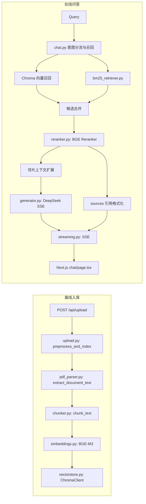

# ChatPDF：跨境电商知识文档问答

ChatPDF 面向亚马逊卖家政策、SOP 等中英混合 PDF，提供上传入库、检索增强问答与引用溯源。当前链路使用 SiliconFlow BGE-M3 向量、默认本地 BM25、SiliconFlow BGE Reranker、DeepSeek Chat，以及可折叠引用卡片。

## 核心能力

- Dense 向量召回与 BM25 关键词召回合并，随后对候选进行 Rerank；Elasticsearch 通过 `USE_ES` / `ENABLE_ES` 可选启用，默认关闭。
- ChromaDB 持久化集合 `chatpdf_collection_bge_m3`，cosine 距离。
- 前端消费 SSE；引用卡片展示 Rerank 分数百分比、页码和 Chunk ID，面板及卡片支持折叠，并对旧文本做换行格式化。
- PDF 按页解析，清理打印页脚/折行噪声，识别标题、列表并保留页码区间；切分代码维护续片标题。

## 架构



## 技术栈

| 层 | 当前实现 |
|---|---|
| 前端 | Next.js 15.5.4、React 19.1、TypeScript 5、Tailwind CSS 4 |
| 后端 | FastAPI 0.115.9、Uvicorn、Python |
| PDF / 向量库 | pdfplumber 0.11.1、ChromaDB 1.0.2 |
| Embedding / Rerank | SiliconFlow `BAAI/bge-m3` / `BAAI/bge-reranker-v2-m3` |
| LLM | DeepSeek `deepseek-chat` |
| 关键词检索 | 本地标准库 BM25；ES 可选 |

## 目录

```text
.
├── README.md
├── INTERVIEW_GUIDE.md
├── docker-compose.yml
├── chatpdf-backend/
│   ├── Dockerfile / requirements.txt / test_chat_retrieval.py
│   └── app/
│       ├── main.py / models.py
│       ├── core/config.py
│       ├── routes/{upload,chat,files}.py
│       ├── services/{pdf_parser,chunker,embeddings,bm25_retriever,es_retriever,reranker,vectorstore,generator}.py
│       ├── utils/streaming.py
│       └── data/{uploads,chroma}/
└── chatpdf-frontend/
    ├── Dockerfile / package.json
    └── src/{app,components,context,hooks,lib}/
```

## 快速开始

### Docker Compose

在本机自行配置 `chatpdf-backend/.env`，至少提供 `SILICONFLOW_API_KEY` 和 `DEEPSEEK_API_KEY`；不要提交密钥。前端 API 地址可通过根目录环境变量 `NEXT_PUBLIC_API_BASE_URL` 配置，默认 `http://localhost:8000`。

```bash
docker compose up -d --build
```

访问 `http://localhost:3000`。Chroma 与上传文件分别持久化至 `chatpdf-backend/app/data/chroma` 和 `chatpdf-backend/app/data/uploads`。

### 本地开发

```bash
cd chatpdf-backend
python -m venv .venv
# Windows: .\.venv\Scripts\Activate.ps1
# macOS/Linux: source .venv/bin/activate
pip install -r requirements.txt
uvicorn app.main:app --host 127.0.0.1 --port 8000 --reload
```

另开终端：

```bash
cd chatpdf-frontend
npm ci
npm run dev
```

后端配置项定义于 `chatpdf-backend/app/core/config.py`，包括 SiliconFlow/DeepSeek Key、模型与 URL、ES 开关、Chroma/上传路径、端口、CORS。前端 `NEXT_PUBLIC_API_BASE_URL` 默认 `http://localhost:8000`，该值会进入浏览器构建，不应放密钥。

## API

| 方法 | 路径 | 说明 |
|---|---|---|
| POST | `/api/upload` | 上传 PDF 并后台索引 |
| GET | `/api/files` | 文件列表 |
| POST | `/api/chat` | JSON 问答 |
| POST | `/api/chat/stream` | SSE 问答 |
| GET | `/api/chat/stream` | GET 流式兼容入口 |

## Roadmap（尚未实现的演进方向）

- 基于更多 PDF 版式样本改进跨页句法愈合和页眉页脚识别。
- 泛化到任意层级的子条款切分和 Parent-Child Chunking。
- 跨语言 Query 改写及检索评测集；以标注数据评估 Recall@K、MRR、nDCG。
- RAGAS 等自动化离线评估，持续监测检索质量、忠实度和引用覆盖率。
