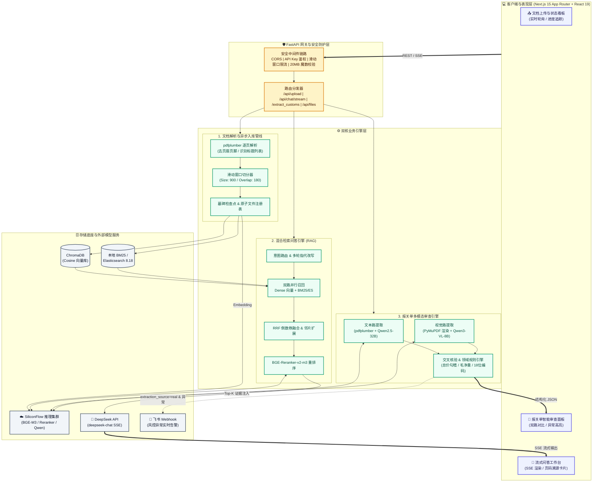
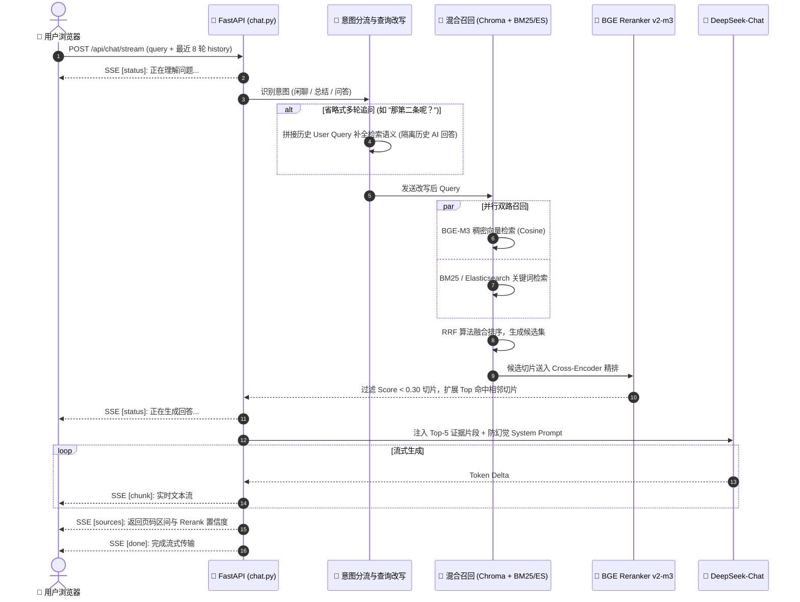
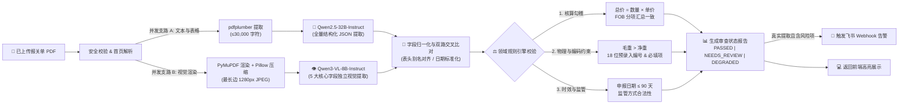

<div align="center">

# 🚢 ChatPDF · 跨境智枢

**面向跨境电商知识库与报关单合规审查的企业级多模态全栈 RAG 系统**

[](https://www.python.org/)
[](https://fastapi.tiangolo.com/)
[-000000?style=flat-square&logo=next.js&logoColor=white)](https://nextjs.org/)
[](https://react.dev/)
[](https://www.trychroma.com/)
[](https://www.deepseek.com/)
[](https://www.docker.com/)

[核心亮点](#-核心工程亮点) •
[系统架构](#-系统整体架构) •
[双引擎流水线](#-核心业务流水线) •
[快速开始](#-快速开始) •
[API 规范](#-api-接口概览) •
[演进规划](#-架构权衡与演进路线)

</div>

---

## 📖 项目简介

**ChatPDF** 是一款聚焦**跨境电商与国际物流场景**的全栈 AI 文档智能应用。系统基于统一的非结构化 PDF 解析与状态注册底座，向上构建了两条核心业务链路：

1. **🔍 混合检索知识问答引擎（Hybrid RAG）**：结合 `BAAI/bge-m3` 稠密向量检索与 `BM25 / Elasticsearch` 稀疏关键词召回，通过 **RRF（倒数秩融合）** 与 `bge-reranker-v2-m3` 交叉重排，配合多轮指代消解与邻片上下文扩展，由 **DeepSeek** 流式生成带精确页码溯源的专业解答。
2. **📑 报关单多模态双路提取与合规校验（Multimodal Audit）**：采用 **文本路（Qwen2.5-32B）+ 视觉路（Qwen3-VL-8B）** 并发提取与交叉印证，内置跨境报关领域规则引擎（单价总价勾稽、毛净重约束、18 位预录入号、FOB 汇总等），支持降级容灾与飞书 Webhook 实时异常告警。

---

## ✨ 核心工程亮点

### 1. 高召回、低幻觉的进阶 RAG 管线
- **多路召回 + RRF 融合 + Cross-Encoder 重排**：并行执行语义向量检索与关键词匹配，经 RRF 算法融合候选集后，通过 `BAAI/bge-reranker-v2-m3` 计算细粒度语义相关性，截断低置信度噪声片段（$\text{Score} < 0.30$）。
- **意图路由与冷启动兜底**：自动识别“闲聊 / 全文总结 / 垂直问答”三类意图；总结类问题优先注入文档首部概览切片；支持 Top 命中切片的**前后相邻切片动态扩展（Neighbor Expansion）**，防止跨段语义断裂。
- **多轮追问改写与防污染设计**：针对“那第二条呢？”、“它有什么限制？”等省略式追问，检索改写器仅融合历史**用户提问**补全检索词，严格隔离模型历史回答参与检索，从根源上杜绝“模型旧幻觉自我强化”。
- **可解释性引用溯源**：SSE 流式输出结束后下发 `source_docs` 元数据，前端精准渲染 1-based 页码区间、Rerank 置信度及片段属性（检索命中 vs. 概览注入）。

### 2. 报关单“文本 + 视觉”双路并发交叉核验
- **异构模型双路印证**：文本路通过 `pdfplumber` 提取结构化文本与表格交由 `Qwen2.5-32B-Instruct` 解析全量字段；视觉路通过 `PyMuPDF` 渲染高分图像交由 `Qwen3-VL-8B-Instruct` 独立提取关键核验字段，解决印章遮挡与排版错位问题。
- **领域级合规规则引擎**：内置强业务约束校验，包括单行核算（$\text{总价} = \text{数量} \times \text{单价}$）、物理逻辑校验（$\text{毛重} > \text{净重}$）、18 位预录入编号格式、申报日期 90 天窗口期、FOB 分项汇总一致性等。
- **可观测状态机与飞书告警**：严格区分 `PASSED`（双路通过）、`NEEDS_REVIEW`（触发风控规则）、`DEGRADED`（单路降级容灾）与 `DEMO` 状态；生产态异常自动推送结构化飞书卡片告警。

### 3. 面向生产的后端工程与并发防护
- **异步任务“墓碑机制（Tombstone）”**：上传索引采用 `queued -> parsing -> embedding -> indexing -> indexed` 五阶段状态机；若用户在后台构建向量期间删除文件，任务会在多个检查点识别删除墓碑并主动回滚清理已写入向量，杜绝“幽灵数据”。
- **跨进程原子文件注册表**：基于进程内锁 + 操作系统文件锁 + 临时文件原子替换（Atomic Replace）管理 `files.json`，保障高并发读写下状态不损坏。
- **纵深安全防护**：1MB 分块流式上传校验、首 1KB `%PDF-` 魔数（Magic Bytes）强校验、目录穿越防御、进程内滑动窗口限流（Rate Limit）及 API Key 鉴权中间件。

---

## 🏗 系统整体架构



---

## 🔄 核心业务流水线

### 链路一：多轮混合检索与重排流水线（Hybrid RAG Pipeline）

系统在召回阶段采用稠密向量与稀疏检索的倒数秩融合算法（Reciprocal Rank Fusion），融合得分计算公式如下：

$$\text{RRF\_Score}(d \in D) = \sum_{m \in \{\text{Dense}, \text{BM25/ES}\}} \frac{1}{k + \text{rank}_m(d)}$$



### 链路二：报关单多模态双路提取与合规风控流

针对跨境报关单版式密集、印章干扰等痛点，系统采用**异步双路并发提取 + 确定性规则校验**架构：



---

## 🛠 技术栈全景

| 领域层次 | 核心技术选型 | 关键特性与工程职责 |
| :--- | :--- | :--- |
| **前端展现层** | Next.js 15.5 (App Router)、React 19.1、TypeScript 5、Tailwind CSS 4 | 响应式工作台、SSE 流式消费、索引状态轮询、报关单双模交互面板 |
| **后端服务层** | Python 3.11、FastAPI 0.115、Uvicorn、Pydantic 2.11 | 异步非阻塞 IO、强类型 Schema 校验、滑动窗口限流与鉴权中间件 |
| **文档工程层** | `pdfplumber` 0.11、`PyMuPDF` (`fitz`)、`Pillow` | 页眉页脚去噪、结构化表格抽取、1-based 页码区间映射、视觉图像渲染 |
| **检索引擎层** | ChromaDB 1.0、本地 BM25、Elasticsearch 8.18（可选） | `chatpdf_collection_bge_m3` 持久化集合、RRF 倒数秩融合算法 |
| **模型推理层** | DeepSeek (`deepseek-chat`)、SiliconFlow API | `BAAI/bge-m3` 向量化、`bge-reranker-v2-m3` 重排、`Qwen2.5-32B`、`Qwen3-VL-8B` |
| **容器与部署** | Docker Compose、Multi-stage Dockerfile | 前后端独立多阶段构建、非 Root 容器运行、健康检查探针、Bind Mount 持久化 |

---

## 🚀 快速开始

### 环境前置要求
- **Python**: `3.11+`
- **Node.js**: `20+`
- **Docker**: Docker Desktop & Docker Compose v2（容器化一键部署推荐）
- **API 密钥**: 需准备 [SiliconFlow API Key](https://siliconflow.cn/)（用于 Embedding / Rerank / Qwen 提取）与 [DeepSeek API Key](https://platform.deepseek.com/)（用于问答生成）。

### 方式一：Docker Compose 一键部署（推荐）

```bash
# 1. 克隆仓库并进入项目根目录
git clone <your-repo-url>
cd chatPDF

# 2. 初始化后端环境变量
cp chatpdf-backend/.env.example chatpdf-backend/.env
```

编辑 `chatpdf-backend/.env`，填入核心密钥：

```dotenv
SILICONFLOW_API_KEY=sk-your-siliconflow-key
DEEPSEEK_API_KEY=sk-your-deepseek-key
DEEPSEEK_API_URL=https://api.deepseek.com/v1
DEEPSEEK_MODEL=deepseek-chat
```

启动服务编排：

```bash
# 3. 构建并后台启动容器
docker compose up -d --build

# 4. 查看服务健康状态与实时日志
docker compose ps
docker compose logs -f backend
```

> **💡 数据安全提示**：Chroma 向量库（`app/data/chroma`）与上传文件（`app/data/uploads`）已配置宿主机挂载持久化。日常重启请使用 `docker compose down`，**切勿附加 `-v` 参数**以免误删业务数据。

### 方式二：本地前后端分离开发

**1. 启动 FastAPI 后端**

```bash
cd chatpdf-backend
python -m venv .venv

# 激活虚拟环境 (Linux/macOS)
source .venv/bin/activate
# 激活虚拟环境 (Windows PowerShell)
.\.venv\Scripts\Activate.ps1

pip install -r requirements.txt
cp .env.example .env  # 填入 SILICONFLOW_API_KEY 与 DEEPSEEK_API_KEY

python -m uvicorn app.main:app --host 127.0.0.1 --port 8000 --reload
```

**2. 启动 Next.js 前端**

```bash
cd chatpdf-frontend
npm ci
cp .env.example .env.local  # 默认连接 http://localhost:8000
npm run dev
```

启动完成后即可访问：
- **前端应用工作台**：`http://localhost:3000`
- **Swagger 交互文档**：`http://localhost:8000/docs`
- **服务健康检查**：`http://localhost:8000/health`

---

## 📡 API 接口概览

| 方法 | 路由路径 | 功能描述 | 备注 |
| :--- | :--- | :--- | :--- |
| `GET` | `/health` | 容器与服务健康探针 | 免鉴权 |
| `POST` | `/api/upload` | 流式上传 PDF 并触发后台解析索引任务 | 校验 `%PDF-` 魔数，上限 20MB |
| `GET` | `/api/files` | 获取全量文档列表、索引阶段与切片统计 | 支持状态展示 |
| `GET` | `/api/files/{file_id}/status` | 轮询单文件实时索引状态 | `queued` $\rightarrow$ `indexed` / `failed` |
| `DELETE` | `/api/files/{file_id}` | 写入删除墓碑并清理 PDF、Chroma 与 ES 数据 | 支持异步任务中途阻断 |
| `POST` | `/api/chat/stream` | **核心流式问答接口（SSE）** | 依次推送 `status` / `chunk` / `sources` / `done` |
| `POST` | `/api/chat` | 同步 JSON 问答接口 | 返回完整回答与溯源切片 |
| `POST` | `/extract_customs` | **报关单文本+视觉双路提取与校验** | 兼容 `/api/extract_customs` |

---

## 📂 项目目录结构与配置参数

<details>
<summary><b>点击展开：完整工程目录树 (Directory Structure)</b></summary>

```text
chatPDF/
├─ .env.example                  # Docker Compose 构建变量示例
├─ docker-compose.yml            # 前后端容器编排与健康检查
├─ chatpdf-backend/              # FastAPI 后端工程
│  ├─ Dockerfile
│  ├─ requirements.txt
│  ├─ test_chat_retrieval.py     # 混合检索、Prompt 构建与 Embedding 单元测试
│  ├─ generate_test_pdf.py       # 测试用 PDF 生成工具
│  └─ app/
│     ├─ main.py                 # 应用入口、中间件挂载与路由注册
│     ├─ models.py               # 问答请求/响应与溯源数据模型
│     ├─ core/
│     │  ├─ config.py            # 统一配置中心 (Pydantic Settings)
│     │  └─ security.py          # 鉴权、滑动窗口限流、流式大小拦截中间件
│     ├─ routes/
│     │  ├─ upload.py            # PDF 流式上传与后台索引生命周期管理
│     │  ├─ files.py             # 文件列表、状态查询与墓碑删除
│     │  ├─ chat.py              # 意图识别、混合检索管线与 SSE 流式问答
│     │  └─ customs_router.py    # 报关单双路提取接口
│     ├─ schemas/
│     │  └─ customs_schema.py    # 报关单结构化字段与校验 Schema
│     ├─ services/
│     │  ├─ pdf_parser.py        # pdfplumber 解析与页码映射
│     │  ├─ chunker.py           # 900/180 滑动窗口切分器
│     │  ├─ embeddings.py        # SiliconFlow Embedding 客户端
│     │  ├─ vectorstore.py       # ChromaDB 向量读写封装
│     │  ├─ bm25_retriever.py    # 内存级标准库 BM25 检索器
│     │  ├─ es_retriever.py      # Elasticsearch 检索与 RRF 融合
│     │  ├─ reranker.py          # BGE Reranker 客户端与超时降级
│     │  ├─ generator.py         # DeepSeek SSE 流式生成客户端
│     │  ├─ extractor_service.py # 报关单 Qwen2.5 + Qwen3-VL 并发提取
│     │  ├─ validator_service.py # 报关单业务规则校验与飞书告警
│     │  └─ file_registry.py     # 跨进程安全的文件注册表与删除墓碑
│     └─ data/                   # 持久化数据目录 (uploads & chroma)
└─ chatpdf-frontend/             # Next.js 15 前端工程
   ├─ Dockerfile
   ├─ next.config.ts            # Standalone 独立产物模式
   └─ src/
      ├─ app/                    # App Router 页面 (首页 / 上传页 / 问答与报关工作台)
      ├─ components/             # React Query Provider 与报关单审查面板
      └─ lib/api.ts              # 统一 API 请求客户端
```
</details>

<details>
<summary><b>点击展开：后端核心环境变量一览表 (Environment Variables)</b></summary>

| 变量名 | 默认值 | 说明 |
| :--- | :--- | :--- |
| `SILICONFLOW_API_KEY` | 空 | **必填**：Embedding、Rerank 与 Qwen 提取模型密钥 |
| `DEEPSEEK_API_KEY` | 空 | **必填**：DeepSeek 问答生成密钥 |
| `EMBEDDING_MODEL` | `BAAI/bge-m3` | 稠密向量模型 |
| `RERANK_MODEL` | `BAAI/bge-reranker-v2-m3` | 交叉重排序模型 |
| `DEEPSEEK_MODEL` | `deepseek-chat` | RAG 问答生成主模型 |
| `TEXT_EXTRACT_MODEL` | `Qwen/Qwen2.5-32B-Instruct` | 报关单文本路提取模型 |
| `VISION_EXTRACT_MODEL` | `Qwen/Qwen3-VL-8B-Instruct` | 报关单视觉路提取模型 |
| `MIN_RELEVANCE_SCORE` | `0.30` | Rerank 相关性过滤阈值 |
| `RERANK_TIMEOUT_SECONDS` | `3.5` | 流式问答链路 Rerank 最大容忍超时（秒） |
| `USE_ES` | `false` | 是否启用 Elasticsearch 替代本地 BM25 |
| `FEISHU_WEBHOOK_URL` | 空 | 报关单异常飞书机器人 Webhook 地址 |
| `API_KEY` / `AUTH_REQUIRED` | 空 / `false` | 后端接口鉴权密钥与强制开启开关 |
| `RATE_LIMIT_ENABLED` | `true` | 是否开启滑动窗口限流（默认上传 10次/分，问答 20次/分） |
| `MAX_UPLOAD_MB` | `20` | 单个 PDF 上传体积上限（MB） |

</details>

---

## 🧪 单元测试

后端内置针对混合检索排序、上下文改写、Prompt 组装及 Embedding 异常重试的单元测试套件：

```bash
cd chatpdf-backend
python -m unittest test_chat_retrieval -v
```

---

## 🧭 架构权衡与演进路线 (Trade-offs & Roadmap)

在当前版本设计中，为了兼顾**轻量化部署**与**核心算法链路完整性**，系统做出了以下工程权衡，并规划了后续演进方向：

- [ ] **分布式异步任务队列**：当前文档解析采用 FastAPI 进程内 `BackgroundTasks` 配合文件锁注册表，适合单实例部署；多副本横向扩展场景下将迁移至 `Celery + Redis` 持久化队列，支持断点续传。
- [ ] **增量倒排索引优化**：默认开启零外部依赖的内存级 BM25（可通过 `USE_ES=true` 无缝切换至 Elasticsearch）；后续将为本地模式引入持久化增量倒排索引，避免大集合全量扫描。
- [ ] **多页报关单与深度 OCR 兜底**：当前报关单提取聚焦首页核心表头与主商品项；后续将引入多页明细流式拼接与专用印章穿透 OCR 兜底。
- [ ] **自动化 RAG 评测体系**：补充基于 `Ragas` 的端到端检索与生成评测集（量化追踪 `Recall@K`、`MRR`、`nDCG` 与 `Faithfulness` 指标）。

---

## 📄 License

本项目采用 [MIT License](LICENSE) 开源协议。