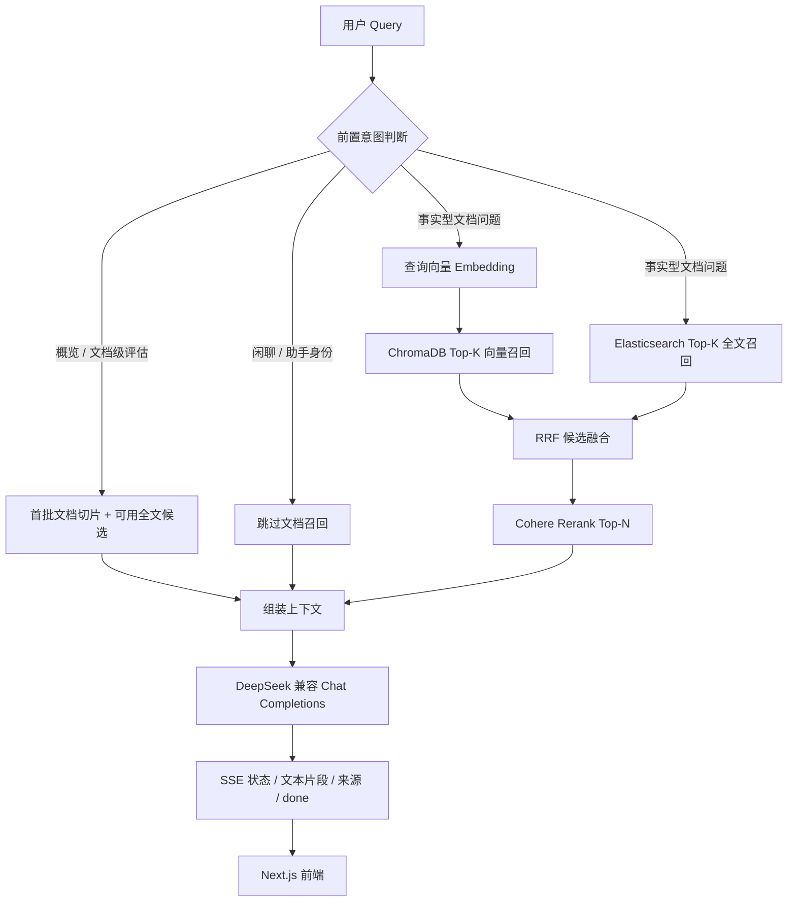

# ChatPDF：面向知识文档的流式问答

ChatPDF 是一个用于跨境电商 SOP、产品说明书、退换货政策与企业知识库资料的 PDF 问答应用。用户上传 PDF 后，服务端按页抽取文本、分块并生成向量；提问时先做轻量意图分流，再组合向量与全文召回、候选融合和 Cohere 重排，最后调用 DeepSeek 兼容接口生成答案。

## 项目简介与核心亮点

- **流式问答：** FastAPI 提供 POST SSE `/api/chat/stream`，按状态、文本片段、来源和结束事件返回；浏览器可以增量展示生成结果。
- **前置意图路由：** `is_chitchat_or_persona_query` 在检索前拦截问候和助手身份问题；文档概览走独立路径，避免把所有输入都送入向量和重排服务。
- **PDF 处理：** `pdfplumber` 按页抽取文本，保留页码元数据；上传接口返回后由 FastAPI `BackgroundTasks` 执行解析、索引。
- **两阶段召回与排序：** ChromaDB 向量召回与 Elasticsearch 全文检索通过 RRF 合并，再由 Cohere Rerank 对候选进行查询相关性排序；Embedding 或 Rerank 出错时有降级路径。
- **可配置运行环境：** API 密钥、模型、存储路径、CORS、端口和检索阈值由后端环境设置统一管理；前端 API 根地址由 `NEXT_PUBLIC_API_BASE_URL` 控制。

## 系统架构与检索流水线



## 技术栈

| 层次 | 技术 | 用途 |
| --- | --- | --- |
| 前端 | Next.js 15、React 19、TypeScript、Tailwind CSS 4 | 页面、PDF 上传、对话与 SSE 消费 |
| API 服务 | Python、FastAPI、Uvicorn | 上传、文件列表、同步问答与流式问答 |
| PDF 处理 | pdfplumber | 按页提取 PDF 文本 |
| 向量检索 | ChromaDB PersistentClient | 保存并查询文本向量 |
| 全文检索 | Elasticsearch Python Client | 文本匹配召回，可与向量结果融合 |
| AI 服务 | Cohere SDK、DeepSeek OpenAI 兼容接口 | Embedding、Rerank、答案生成 |
| 辅助依赖 | LlamaIndex、Pydantic、httpx | 依赖清单中的框架与数据/HTTP 支持；当前检索链路由 `app/services` 自行编排 |

## 目录结构

```text
.
├── README.md
├── .gitignore
├── chatpdf-backend/
│   ├── .env.example
│   ├── requirements.txt
│   └── app/
│       ├── core/config.py       # 环境设置与路径解析
│       ├── main.py              # FastAPI 应用、CORS、路由注册
│       ├── models.py            # 请求与响应模型
│       ├── routes/              # 上传、聊天、文件列表 API
│       ├── services/            # PDF、分块、Embedding、检索、Rerank、生成
│       ├── utils/streaming.py   # SSE 编码与断连清理
│       └── data/                # 本地上传与 Chroma 持久化（忽略运行数据）
└── chatpdf-frontend/
    ├── .env.example
    ├── package.json
    └── src/
        ├── app/                 # Next.js 页面与路由
        ├── components/          # 上传和聊天 UI
        ├── hooks/               # 聊天状态/流式请求逻辑
        └── lib/api.ts           # 统一 API 根地址与请求封装
```

## 快速启动（Local Setup）

### 1. 准备后端环境

```powershell
cd chatpdf-backend
Copy-Item .env.example .env
py -3.11 -m venv .venv
.\.venv\Scripts\Activate.ps1
pip install -r requirements.txt
```

编辑 `chatpdf-backend/.env`，填写 `COHERE_API_KEY` 与 `DEEPSEEK_API_KEY`。若启用 Elasticsearch 全文召回，也要让 `ES_HOST` 指向可用实例；向量召回依赖 Cohere embedding。CORS 默认允许本地 Next.js 的 3000 端口，部署时请将 `ALLOWED_ORIGINS` 改成逗号分隔的实际前端来源。

启动后端：

```powershell
uvicorn app.main:app --host 127.0.0.1 --port 8000 --reload
```

也可用 `python -m app.main` 启动；监听端口由 `BACKEND_PORT` 控制。

### 2. 准备前端

在另一个终端执行：

```powershell
cd chatpdf-frontend
Copy-Item .env.example .env.local
npm ci
npm run dev
```

浏览器打开 `http://localhost:3000`。`NEXT_PUBLIC_API_BASE_URL` 默认指向 `http://localhost:8000`；通过环境变量可切换到部署后的 FastAPI 地址。该变量会进入浏览器端构建，不应放置密钥。

### 3. 基本使用

上传 PDF 后等待后台处理完成，再选择文档并提问。默认切分为 1200 字符、200 字符重叠；聊天请求默认 `top_k=5`，相关性来源阈值默认为 `0.30`。

## API 概览

| 方法 | 路径 | 说明 |
| --- | --- | --- |
| POST | `/api/upload` | 接收 `multipart/form-data` 的 PDF，返回文件 ID 并后台索引 |
| GET | `/api/files` | 返回本地文件清单 |
| POST | `/api/chat` | 等待完整答案后返回 JSON |
| POST | `/api/chat/stream` | SSE 流式回答，事件包括 `status`、`chunk`、`sources`、`done`、`error` |

> 当前上传实现以本地文件与本地 Chroma 持久化为主；生产部署应为上传存储、任务队列、访问控制、限流和多实例向量库制定独立方案。
